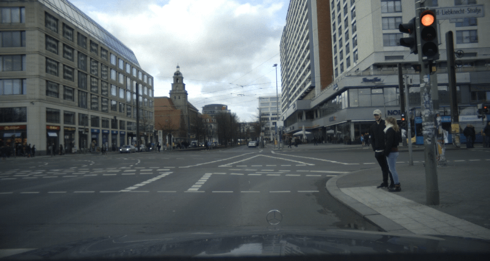
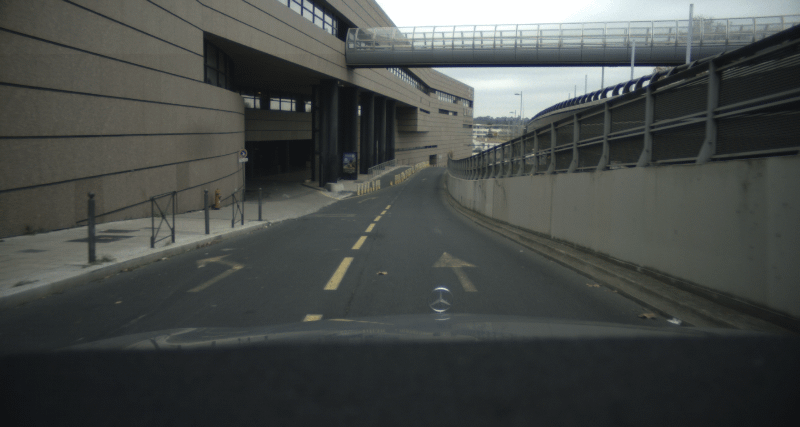
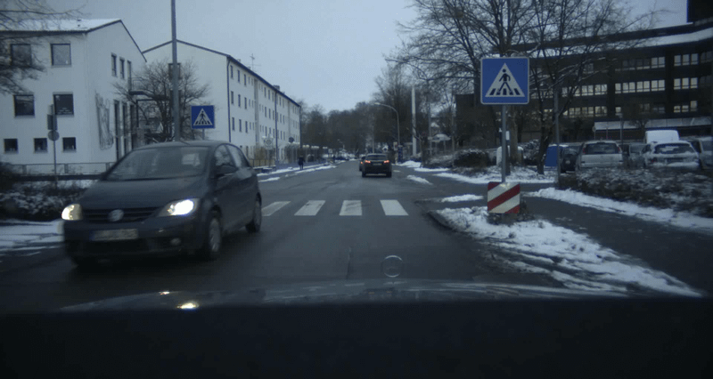
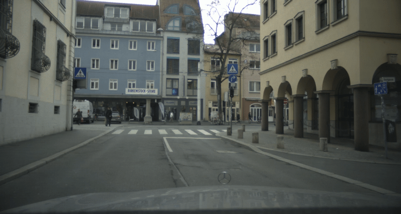

# Contrastive-SDXL

Official PyTorch implementation of [*Mitigating Illumination-Induced Domain Shift in Night-Time Pedestrian Detection for Intelligent Vehicles using Annotation-Preserving Diffusion Augmentation*](https://arxiv.org/abs/2605.16406).

Contrastive-SDXL is a diffusion-based data augmentation framework designed to mitigate illumination-induced domain shift in night-time pedestrian detection. It leverages unpaired daytime and night-time driving images to learn day-to-night translation while preserving pedestrian instances and scene structure, enabling the reuse of existing daytime bounding-box annotations for downstream detector training.

Built upon SDXL-Turbo, the framework incorporates Low-Rank Adaptation (LoRA) and VAE skip connections to support efficient image-to-image translation. Annotation preservation is encouraged through DINOv2-guided semantic contrastive learning and detector-guided object consistency, while adversarial learning and identity regularisation facilitate adaptation to the night-time domain without unnecessary alterations to scene content.

## Day-to-night translation

<table>
  <tr>
    <td></td>
    <td></td>
  </tr>
  <tr>
    <td></td>
    <td></td>
  </tr>
</table>

## Framework


The generator encodes a source image into the VAE latent space, applies one text-conditioned UNet denoising step, and decodes the result using encoder features supplied through skip connections. SDXL's two frozen text encoders provide prompt conditioning.

To encourage annotation-preserving translation and adaptation to the target night-time domain, the framework integrates four auxillary training objectives

| Training objective | Implementation |
| --- | --- |
| Semantic consistency | Frozen DINOv2 ViT-g/14 block features are extracted from source and translated images. Corresponding patches are projected and normalised before computing semantic relation consistency (SRC) and hard-negative contrastive (hDCE) losses. |
| Object consistency | A frozen YOLO11 detector evaluates preservation of pedestrian instances and their spatial correspondence with the original bounding-box annotations accounting for training resize, crop, and horizontal flip. Enable with `--det_loss`. |
| Adversarial alignment | A vision-aided discriminator uses a frozen encoder and trainable discriminator heads to distinguish generated images from real night-time images. |
| Identity regularisation | Real night-time images are passed through the generator and compared with their inputs using L1 and VGG-based losses. Enable with `--dce_idt`. |

By default, semantic supervision uses DINOv2 blocks `30,32,34,36,38`, with 128 sampled patches per layer and 256-dimensional projected features. SRC and hDCE weights increase linearly from 0.01 to 1 over the first 12,000 iterations, multiplied by their respective loss coefficients. Object consistency begins after 7,000 completed iterations.

## Repository structure

```text
contrastive-sdxl/
├── docs/                         # Framework infographic and translation GIFs
├── src/contrastive_sdxl/
│   ├── train.py                  # SDXL training loop
│   ├── inference.py              # Image translation command
│   ├── model.py                  # Generator and trainable parameter selection
│   ├── arguments.py              # SDXL command-line options
│   ├── checkpoints.py            # Generator checkpoint loading and saving
│   ├── schedules.py              # Diffusion and loss-weight schedules
│   ├── data/                     # Image loading, transforms, and guidance labels
│   ├── models/                   # UNet, VAE, text encoders, DINOv2, patch projector
│   ├── losses/                   # SRC, hDCE, and detector guidance
│   └── detector/                 # YOLO dataset preparation, training, and prediction
├── data/                         # Local datasets and annotations
├── outputs/
│   ├── checkpoints/              # SDXL and detector weights
│   ├── generated/                # Translation and detector prediction outputs
│   ├── evaluations/              # Detector validation results
│   └── logs/                     # Training configuration, metrics, and W&B logs
├── environment.yml
└── pyproject.toml
```

## Prerequisites and installation

Use Conda and a CUDA-capable NVIDIA GPU for training. The supplied environment targets Linux and pins Python 3.13.2, PyTorch 2.6.0, Diffusers 0.33.1, Accelerate 1.6.0, and CUDA 12 libraries. CPU execution is available through `--device cpu`.

Run these commands from the project directory containing `environment.yml` and `pyproject.toml`:

```bash
conda env create -f environment.yml
conda activate contrastive_sdxl
```

The environment file installs the package in editable mode. Initial model loading requires network access to retrieve SDXL-Turbo, DINOv2, and the pretrained networks used by the adversarial and LPIPS objectives, unless those weights are already cached. A local DINOv2 checkout can be supplied through `--dino_repo`.

## Data preparation

Arrange the images and annotations as follows:

```text
data/
├── ECP/
│   ├── train_src/                  # Daytime source images
│   ├── train_tgt/                  # Unpaired night-time target images
│   ├── test_src/                   # Optional daytime images for inference
│   ├── test_tgt/                   # Optional night-time images
│   ├── annotations/
│   │   └── day_train_all.json      # COCO-format source annotations
│   └── labels/
│       └── train_src/              # YOLO-format labels for detector guidance
└── yolo/
    └── ecp/                        # Prepared detector dataset and ecp.yaml
```

Both training image directories must contain images. Source and target images are sampled without paired correspondence. The default preprocessing resizes each image's shorter side to 640 pixels, takes a random 512 × 512 crop, and applies random horizontal flipping. Images are normalised to `[-1, 1]`.

For detector guidance, each source image needs a label file with the same filename stem, such as `train_src/image_001.png` and `labels/train_src/image_001.txt`. Each row contains `class cx cy width height`, with coordinates normalised to the original image dimensions. Images without annotated objects need an empty label file.

Generate these labels from the source COCO annotations if they have not already been prepared:

```bash
python -m contrastive_sdxl.detector.prepare \
  --mode labels \
  --coco_json data/ECP/annotations/day_train_all.json \
  --labels_dir data/ECP/labels/train_src \
  --names pedestrian
```

The destination must be empty. The conversion selects the `pedestrian` category and excludes crowd annotations by default.

### Preparing the guidance detector

An ECP-trained YOLO11 pedestrian detector is provided at `outputs/checkpoints/yolo11/best.pt` through Git LFS. This checkpoint supplies detector guidance during Contrastive-SDXL training and can be used directly with `--det_loss --detector_weights outputs/checkpoints/yolo11/best.pt`. The detector remains frozen during training.

After cloning, ensure Git LFS is installed and run the following from the repository root to download the checkpoint:

```bash
git lfs pull
```

To train your own guidance detector instead, first prepare its dataset, then train:

```bash
python -m contrastive_sdxl.detector.prepare \
  --mode train \
  --coco_json data/ECP/annotations/day_train_all.json \
  --images_root data/ECP/train_src \
  --out_root data/yolo/ecp \
  --val-ratio 0.1

python -m contrastive_sdxl.detector.train \
  --data data/yolo/ecp/ecp.yaml \
  --model yolo11l.pt \
  --epochs 100 \
  --imgsz 1280 \
  --device 0 \
  --name yolo11
```

Dataset preparation requires an empty output directory. Detector training writes `best.pt` and `last.pt` under `outputs/checkpoints/yolo11/` and validation results under `outputs/evaluations/`. If that checkpoint directory is already occupied, use a different `--name` and update the guidance-weight path accordingly.

## Training

The following command enables all four training objectives and uses the supplied YOLO11 checkpoint. Prepare the source-image guidance labels as described above and download the checkpoint before starting training.

```bash
python -m contrastive_sdxl.train \
  --dataset_folder data/ECP \
  --output_dir outputs \
  --prompt "Driving at night." \
  --max_train_steps 15000 \
  --train_batch_size 1 \
  --gradient_accumulation_steps 1 \
  --mixed_precision no \
  --gradient_checkpointing \
  --dce_idt \
  --det_loss \
  --detector_weights outputs/checkpoints/yolo11/best.pt \
  --labels_dir data/ECP/labels/train_src \
  --report_to wandb
```

The current training command supports one process, batch size 1, and gradient accumulation of 1. It uses SDXL-Turbo, a default learning rate of `5e-6`, and UNet/VAE LoRA ranks of 64/4.

The prompt is supplied directly through `--prompt`. Omit `--det_loss` to train without detector guidance, or `--dce_idt` to disable identity regularisation. Detector guidance requires `sdxl_random_crop_512` preprocessing. Loss coefficients are controlled through `--lambda_SRC`, `--lambda_HDCE`, `--lambda_det`, `--lambda_gan`, `--lambda_idt`, and `--lambda_idt_lpips`.

For online W&B logging, authenticate with `wandb login`. Use `--report_to none` to disable W&B. Training configuration and per-iteration losses are always written to `outputs/logs/training_args.json` and `outputs/logs/training.jsonl`. W&B files also use the logs directory.

Generator checkpoints are written to `outputs/checkpoints/day2night/model_<step>.pkl`.

## Inference

Use a generator checkpoint produced by the current training code. The current inference command processes every `.pkl` file in the directory containing `--model_path`. To use a single checkpoint, place it in a directory containing only that checkpoint:

```bash
mkdir -p outputs/checkpoints/inference
cp outputs/checkpoints/day2night/model_14501.pkl \
  outputs/checkpoints/inference/model_14501.pkl

python -m contrastive_sdxl.inference \
  --input_dir data/ECP/test_src \
  --model_path outputs/checkpoints/inference/model_14501.pkl \
  --output_dir outputs/generated/day2night \
  --prompt "Driving at night." \
  --image_prep resize_512 \
  --device cuda \
  --seed 42
```

Replace `model_14501.pkl` with the checkpoint you wish to use. For one image, replace `--input_dir data/ECP/test_src` with `--input_image path/to/image.png`. Folder input is recursive by default, `--no_recursive` limits it to the specified directory.

`resize_512` processes images at 512 × 512 pixels, then restores the original dimensions when saving. Use `--image_prep no_resize` for native-resolution processing; both dimensions must be divisible by 8.

Full command-line options are available through:

```bash
python -m contrastive_sdxl.train --help
python -m contrastive_sdxl.inference --help
```

## Citation

If you use Contrastive-SDXL in your research, please cite the [original work](https://arxiv.org/abs/2605.16406):

```bibtex
@misc{george2026mitigatingilluminationinduceddomainshift,
  title = {Mitigating Illumination-Induced Domain Shift in Night-Time Pedestrian Detection for Intelligent Vehicles using Annotation-Preserving Diffusion Augmentation},
  author = {Franky George and Muhammad Khalid and Adil Khan and Koorosh Aslansefat},
  year = {2026},
  eprint = {2605.16406},
  archivePrefix = {arXiv},
  primaryClass = {cs.CV},
  url = {https://arxiv.org/abs/2605.16406}
}
```
